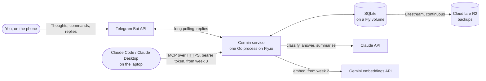
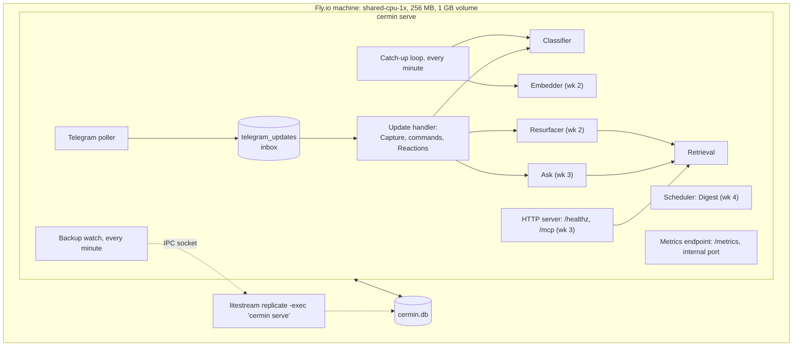
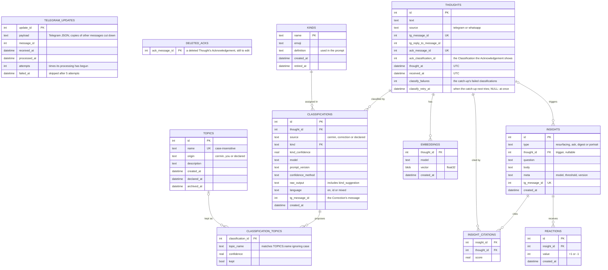
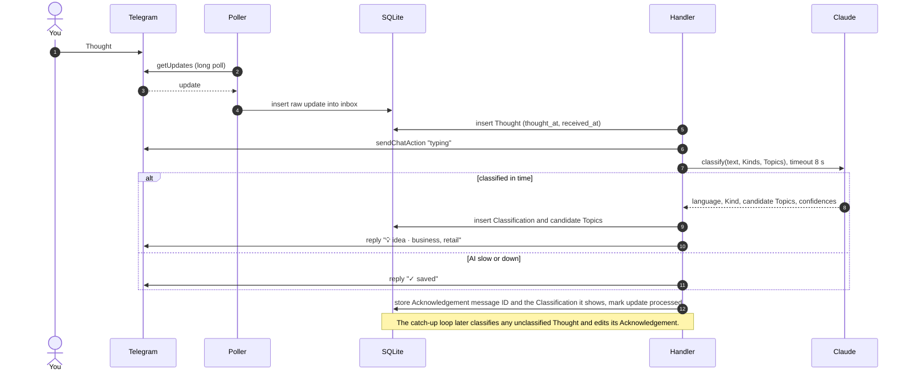

# Cermin: high-level design

Status: **accepted**, 2026-10-09. Each week updates its own open questions ([section 10](#10-designed-in-their-week)). Product: [PRD](../product/PRD.md). Vocabulary: [CONTEXT.md](../../CONTEXT.md). Decisions: [docs/adr/](../adr/).

This document describes the whole v1 solution, weeks 1 to 4. The choices that are hard to undo are settled here: runtime, storage, hosting, AI provider, capture pipeline, MCP transport and data model. Thresholds and algorithms are designed in their own week; [section 10](#10-designed-in-their-week) lists them. That covers strong Topic, strong Resurfacing match, Loops, Digest, Portrait and Declared Topic matching.

## 1. Capacity plan

| Quantity | Estimate | Basis |
|---|---|---|
| Thoughts | 5/day on average; plan for 30/day peaks | PRD |
| Corpus size | ~75 imported from WhatsApp, then ~150/month: ~400 by 8 Nov, ~2,000 after a year | 3 Oct to go-live at 5/day |
| Thought length | ~200 characters (~60 tokens) on average; 4,096 max | Telegram message limit |
| Telegram updates | 10 to 40/day: Thoughts, commands, Reactions | |
| LLM calls | 10 to 30/day: one Classification per Thought, plus Ask, weekly Digest and occasional Portrait | |
| Tokens | under 1M/month in total | |
| MCP calls | tens/day at most | |
| Storage per Thought | ~20 KB: text 0.5 KB, raw update 2 KB, Classifications 3 KB, embedding ~12 KB (3,072 float32) | |
| Database size | ~10 MB by 8 Nov, ~40 MB after a year | |
| Similarity search | brute force: 2,000 × 3,072 ≈ 6M multiply-adds per query, about a millisecond; all vectors in RAM ≈ 25 MB | no vector index needed below ~100k Thoughts |
| Concurrency | one writer; a few concurrent readers (MCP) | |

### Monthly cost

| Item | Cost |
|---|---|
| Fly.io machine, shared-cpu-1x 256 MB, `iad` | $2.19 |
| Fly volume, 1 GB | $0.15 |
| Backups on Cloudflare R2 (free tier: 10 GB, free egress) | $0 |
| Metrics on Fly's managed Prometheus and Grafana (no charge today; Fly gives notice before that changes) | $0 |
| Classification on Claude Sonnet 5.5 ($2 / $10 per MTok), low effort: 150 × ~1.5k in, ~350 out | ~$1 to $1.50 |
| Ask on Claude Sonnet 5.5: ~60 × 5k in, 500 out | ~$0.90 |
| Digest on Sonnet 5.5: 4 runs | ~$0.20 |
| Portrait on Claude Opus 5.5 ($4 / $20): ~4 runs × 30k in, ~15k out incl. thinking | ~$1.70 |
| Embeddings, gemini-embedding-2 ($0.20 per MTok) | < $0.01 |
| Week-3 evaluation reruns (Haiku, Sonnet, Opus on the labelled set, via the Batch API at half price) | ~$2, once |
| **Total** | **≈ $8 in the month with evaluation, ≈ $6 otherwise; under the $10 cap** |

The models for Ask, Digest and Portrait are upper bounds; each picks its own in its week. Both AI provider accounts have spend caps.

## 2. Non-functional requirements

| Area | Requirement | How it is met |
|---|---|---|
| Capture durability | A Thought that Telegram accepted is never lost. | The raw update is committed to SQLite before any AI call. Telegram keeps undelivered updates for 24 h. Litestream streams the database to R2, so at most ~1 s of data is at risk. |
| Capture independent of AI | A slow or failing AI never blocks saving. | The Acknowledgement goes out once classification finishes or after 8 s, whichever comes first. A catch-up loop classifies the Thought later and edits the Acknowledgement. |
| Latency | Acknowledgement ≤ 8 s (typically a few seconds). Resurfacing ≤ 10 s after Capture. `/ask` ≤ 30 s. MCP search ≤ 2 s. | One process, local SQLite, brute-force search in memory. |
| Availability | Best effort on one machine. An outage of up to 24 h loses nothing. A deploy means a few seconds of downtime. | Telegram buffers updates; MCP clients retry; Fly restarts the process when it exits. A failing `/healthz` takes the machine out of routing but doesn't restart it ([5.4](#54-monitoring)). |
| Recovery | Under 1 h to rebuild from backup. | `litestream restore` onto a fresh volume; restore drill in week 1. |
| Privacy | The Corpus is never public. | Owner-only bot, by Telegram user ID. MCP behind a bearer token over TLS. Paid AI tiers only, which don't train on inputs. Thought text is never written to logs. `/delete` scrubs the database; backups age out after 7 days. |
| Security | No secrets or real Thoughts in the repo or its issues. | Fly and GitHub secrets; test fixtures use made-up Thoughts. |
| Cost | ≤ $10/month for everything. | [Section 1](#monthly-cost). |
| Portability | Someone else can run their own Cermin on other hosting or models. | Nothing in the code is host-specific: one binary, a SQLite file and environment variables, needing only a disk and outbound internet. Long polling needs no inbound URL. Each AI provider sits behind one function (`classify`, `embed`) with the model name in config, so another provider is one new implementation ([ADR-0006](../adr/0006-claude-classification-gemini-embeddings.md)). |
| Evaluability | Everything week 3 needs to measure accuracy and calibration exists from day 1. | [Section 6.4](#64-recorded-from-day-1). |
| Language | English, Bahasa Indonesia and mixed Thoughts are accepted. | Kind and Topic names are English, except a Declared Topic's; prose follows the Thought's language. |
| Operability | One person can run it. | One binary; deploy on push to `main`; structured logs; schema migrations embedded in the binary. Metrics on Fly's dashboard, saved SQL queries, and a Telegram message when backups fall behind ([5.4](#54-monitoring)). |

## 3. High-level diagram

## 4. Architecture

| Component | Week | Responsibility |
|---|---|---|
| Telegram poller | 1 | In its own goroutine, long-polls `getUpdates`, writes each raw update into the `telegram_updates` inbox, then confirms the offset and wakes the update handler. It never waits for the handler, so a backlog can't hold up `getUpdates` past `/healthz`'s window ([8.4](#84-http)). |
| Update handler | 1 | In its own goroutine, at startup and whenever the poller wakes it, works through inbox rows in order: owner check, Capture, `/delete`, `/kind`, `/topics`, edge cases; later `/ask`, `/topic` and Reactions. An update whose processing has begun 5 times is skipped: it is marked failed and kept for a replay, an error is logged, and you get a reply saying so. |
| Classifier | 1 | One Claude call per Thought with structured output: Kind, candidate Topics, stated confidences, language, `kind_suggestion`. |
| Catch-up loop | 1 | Every minute: sends missing Acknowledgements and edits out-of-date ones, and edits deleted Thoughts' Acknowledgements to `🗑 deleted` where `/delete` failed to, at most 20 of each, then classifies Thoughts that have no Classification and edits their Acknowledgements. After each failure on a Thought it waits longer before trying it again: 1, 2, 4 … minutes, at most 24 hours, so a Thought the classifier always fails on costs 11 calls on its first day and one a day after that. From week 2 it also embeds. |
| HTTP server | 1 | `/healthz` for Fly; `/mcp` from week 3. |
| Metrics endpoint | 1 | `/metrics` for Fly's Prometheus, on its own internal port ([5.4](#54-monitoring)). |
| Backup watch | 1 | Every minute, asks Litestream whether changes are waiting to reach R2. Tells you in Telegram once they have waited 1 h, and again when they catch up ([5.4](#54-monitoring)). |
| Embedder | 2 | Embeds Thoughts and queries; backfills when the embedding model changes. |
| Resurfacer | 2 | Finds strong matches for a new Thought and sends at most 2 as an Insight with 👍/👎. |
| Retrieval | 2 to 3 | Brute-force cosine over in-memory vectors, filtered by Topic, Kind or time. Shared by Resurfacing, Ask and MCP. |
| Ask | 3 | `/ask`: retrieval, then Claude answers with citations. |
| MCP handler | 3 | Read-only tools over Streamable HTTP. |
| Scheduler | 4 | Sunday-morning Digest (WIB); runs a missed Digest on startup. |
| Litestream | 1 | Wraps the process, replicates the database to R2, restores on boot when the volume is empty. |

## 5. Runtime decisions

| Decision | Record | Summary |
|---|---|---|
| Language | | Go for all of v1. |
| Process shape and storage | [ADR-0003](../adr/0003-one-process-embedded-sqlite.md) | One binary, one process: bot, workers, MCP endpoint and scheduler. SQLite in WAL mode with a pure-Go driver, replicated by Litestream. Subcommands handle one-off jobs: `serve`, `import` (wk 2), `eval` (wk 3). |
| MCP transport | [ADR-0004](../adr/0004-remote-mcp-bearer-token.md) | Streamable HTTP inside the same process, bearer token, no OAuth in v1. |
| Hosting | [ADR-0005](../adr/0005-fly-single-machine-r2-backups.md) | Fly.io, one always-on machine in `iad`; Litestream backups on Cloudflare R2. |
| AI provider | [ADR-0006](../adr/0006-claude-classification-gemini-embeddings.md) | Claude Sonnet 5.5 classifies from day 1; gemini-embedding-2 from week 2; paid tiers only. |
| Capture pipeline | [ADR-0007](../adr/0007-capture-durable-inbox-long-polling.md) | Long polling into a database inbox; the Thought is saved before any AI call. |
| Data model | [ADR-0008](../adr/0008-append-only-classifications.md) | Append-only Classifications; every candidate Topic stored; Kinds in a table changed only by migrations. |
| Code layout | [ADR-0009](../adr/0009-domain-package-and-inward-imports.md) | Clean architecture's dependency rule without its layer directories: the domain in `internal/cermin`, use cases and adapters as sibling packages, wiring in `cmd/cermin`. See [5.2](#52-code-layout). |
| Deploy | | GitHub Actions runs `go vet` and `go test` on every push, then `fly deploy` on `main` once they pass. The inbox makes this safe: a handler bug leaves updates unprocessed, not lost. |
| Monitoring | | Metrics about running Cermin on Fly's managed Prometheus; numbers about your use from SQL; one alert, for backups. See [5.4](#54-monitoring). |

### 5.1 Environments

| | Production | Development |
|---|---|---|
| Where | the Fly machine | whoever is coding: your laptop or an agent's sandbox |
| Telegram bot | the production bot you use daily | a separate dev bot, since two pollers can't share a token |
| Database | `/data/cermin.db` on the Fly volume, replicated to R2 | `data/cermin.db` (gitignored) |
| Purpose | serves you | tries changes before they deploy; never serves you |

The laptop also hosts the MCP client (Claude Code or Desktop). In week 3, evaluation runs there on a copy restored from R2. Neither of these serves the product.

### 5.2 Code layout

Module `github.com/arkoes07/cermin`. Imports point inward, toward `internal/cermin`, which imports only the standard library ([ADR-0009](../adr/0009-domain-package-and-inward-imports.md)):

| Path | Role | Holds |
|---|---|---|
| `internal/cermin/` | domain | the glossary types (Thought, Kind, Classification, candidate Topics) and the rules about them that need no I/O, such as the keep rule (`KeepTopics`) |
| `internal/capture/` | use case | the inbox handler, commands, the catch-up loop |
| `internal/sqlite/` | adapter | SQLite access; migrations embedded and tracked with `PRAGMA user_version`; `PRAGMA foreign_keys = ON` |
| `internal/claude/` | adapter | Claude API calls; today the classification call, with its prompt and output schema |
| `internal/telegram/` | adapter | Bot API client over `net/http`: `getUpdates`, `sendMessage`, `editMessageText`, `sendChatAction` |
| `cmd/cermin/` | wiring | `main` with subcommands: `serve` (wk 1), `import` (wk 2), `eval` (wk 3); reads the environment and builds every part with its constructor, without a dependency-injection library |

Later weeks add packages when they need them. New code goes in the first place that fits:

1. **A glossary term, or a rule about one that needs no I/O**: `internal/cermin`.
2. **Code that calls out of the process** (an API, the database, a file format): an adapter, named after what it talks to (`telegram`, `claude`, `sqlite`, `gemini`, `whatsapp`), so the glossary's words stay free for the domain and the use cases. `embed` is taken by the standard library and `import` is a Go keyword, hence `gemini` and `whatsapp`. An adapter may import `internal/cermin` and nothing else in this module.
3. **Code that drives the adapters**: something you do or receive (Capture, Correction, Resurfacing, Ask, Digest), an endpoint that receives requests (MCP), or logic several of them share (Retrieval). It goes in a use-case package named after its job, such as `resurface`, `ask`, `digest`, `mcp` or `retrieval`. A use case may import `internal/cermin`, adapters and other use cases, and calls adapters directly. It declares a function type or interface for an adapter only when a second implementation arrives or a test needs a fake that a real instance can't provide, as `capture.ClassifyFunc` does for the Claude call.
4. **Reading the environment, choosing implementations, building each part and starting it**: `cmd/cermin`. A part may still run goroutines of its own.

Once week 3 adds a second classifier ([#10](https://github.com/Arkoes07/cermin/issues/10)), a `classify` use case takes the classifier adapters, such as `claude` and `jev`, and combines them behind one `Classify` method; `cmd/cermin` passes it to `capture` as its `ClassifyFunc`, and `capture` doesn't change. Until then `cmd/cermin` passes `claude`'s `Classify` directly, since a `classify` package would only forward the call.

Libraries:
- `modernc.org/sqlite`;
- the official Anthropic Go SDK (`github.com/anthropics/anthropic-sdk-go`);
- the official MCP Go SDK (`github.com/modelcontextprotocol/go-sdk`), from week 3;
- the Prometheus Go client (`github.com/prometheus/client_golang`), for `/metrics`;
- the standard library for everything else.

### 5.3 Configuration and secrets

| Variable | Week | Where it is set | Purpose |
|---|---|---|---|
| `TELEGRAM_BOT_TOKEN` | 1 | Fly secret; `.env` locally | Production or dev bot token |
| `TELEGRAM_OWNER_ID` | 1 | Fly secret; `.env` | Your numeric Telegram user ID; every other sender is ignored |
| `ANTHROPIC_API_KEY` | 1 | Fly secret; `.env` | Claude |
| `CERMIN_DB_PATH` | 1 | `fly.toml` (`/data/cermin.db`); default `data/cermin.db` | Database file |
| `CERMIN_CLASSIFY_MODEL` | 1 | optional; default `claude-sonnet-5-5` | Classification model |
| `R2_ENDPOINT`, `R2_BUCKET`, `LITESTREAM_ACCESS_KEY_ID`, `LITESTREAM_SECRET_ACCESS_KEY` | 1 | Fly secrets | Litestream replica on R2 |
| `FLY_API_TOKEN` | 1 | GitHub Actions secret | Deploy on push to `main` |
| `CERMIN_LITESTREAM_SOCKET` | 1 | `fly.toml`; unset locally | Litestream's IPC socket, read by the backup watch; unset turns the watch off |
| `GEMINI_API_KEY` | 2 | Fly secret; `.env` | Embeddings |
| `CERMIN_MCP_TOKEN` | 3 | Fly secret; MCP client config | MCP bearer token |

Values that only change with a deploy are constants in code: the WIB timezone (`Asia/Jakarta`), the 8 s Acknowledgement wait, the 0.5 placeholder keep threshold, the metrics port (9091) and the backup watch's 1 h threshold.

### 5.4 Monitoring

Two kinds of number live in two places. Numbers about running Cermin go to Fly's managed Prometheus and are graphed in its Grafana at fly-metrics.net. Numbers about your use of Cermin are already in the database and come from SQL.

| Where | What | How |
|---|---|---|
| fly-metrics.net | Claude calls by purpose, model and outcome; calls per Thought; call duration; tokens, turned into cost by the model's price in the panel's query; how long changes have waited to reach R2; Go runtime and machine metrics | Fly scrapes `/metrics` on port 9091. Only fly.toml's `[metrics]` section names that port, so it is never public: call counts by the hour would show when you think. Fly keeps about 15 days. The dashboard is built by hand, then exported to `docs/ops/dashboard.json` once it settles. |
| SQL on the live database | Thoughts per day, the success checks, Corrections, Acknowledgements sent as `✓ saved` | `fly ssh console -C "sqlite3 -readonly -box /data/cermin.db"`, then a query from [`docs/ops/queries.sql`](../ops/queries.sql) |
| `fly logs` | the `slog` lines | No log sink. |
| Anthropic Console, monthly | the bill | Checks that the cost worked out from tokens matches it. |

Metrics:
- `cermin_claude_requests_total{purpose, model, outcome}`, `cermin_claude_request_duration_seconds{purpose, model}` and `cermin_claude_tokens_total{purpose, model, direction}`, recorded by `internal/claude`. `purpose` is `classify` until week 3 adds `answer`. Each AI adapter records its own calls, so adapters still import nothing else in this module ([5.2](#52-code-layout)).
- `cermin_thoughts_captured_total`, recorded by `internal/capture`, turns calls into calls per Thought.
- `cermin_backup_unsynced_seconds`, recorded by the backup watch.
- Go runtime metrics, from the client's default registry.

**One alert.** Every minute the backup watch asks Litestream, over its IPC socket, whether the database has changes not yet on R2, and remembers when it first saw them waiting. Once they have waited 1 h, the bot tells you in Telegram, and it tells you again when backups catch up. The state lives in memory, so a restart starts the count again. With `CERMIN_LITESTREAM_SOCKET` unset, as in development, the watch is off. The code is a `litestream` adapter for the socket and a `backup` use case for the watch.

Nothing else alerts. A dead process shows as silence after your next Thought: at ~5 Thoughts a day you notice within a day, and Telegram keeps updates for 24 h. A failing classifier shows as an Acknowledgement stuck at `✓ saved`, and a skipped update gets a reply.

**Health.** Fly doesn't restart a Machine whose health check fails. A failing `/healthz` takes it out of routing, which blocks `/mcp` from week 3, shows in `fly checks list`, and fails a deploy. No watchdog restarts it: every call the poller makes has a timeout and it retries forever, so a stale poller means trouble with Telegram, the network or the token, none of which a restart fixes. A crash exits the process, and Fly restarts that.

Not built, and when to add it:
- **`/stats` in the bot**, if you want the numbers away from a laptop.
- **A table of AI calls**, if a question needs more than 15 days of history, or the cost of one Thought.
- **Anthropic's Usage and Cost API**, if the cost worked out from tokens drifts from the bill. It needs an Admin key, which doesn't belong on the server, and reports by day only.
- **An uptime monitor or other alerts**, if silence goes unnoticed for more than a day.
- **A log sink**, when you need logs older than Fly keeps.

## 6. Data model

Each table is created in the week that first needs it:
- **Week 1:** `telegram_updates`, `thoughts`, `deleted_acks`, `kinds`, `topics`, `classifications`, `classification_topics`.
- **Week 2:** `embeddings`, `insights`, `insight_citations`, `reactions`.

### 6.1 Where each glossary term lives

| [CONTEXT.md](../../CONTEXT.md) term | Stored as |
|---|---|
| Thought | a `thoughts` row |
| Thought time | `thoughts.thought_at` |
| Capture | turning a `telegram_updates` row into a `thoughts` row |
| Acknowledgement | the Telegram message whose ID is `thoughts.ack_message_id`; not stored as a row |
| Kind | a `kinds` row |
| Classification | a `classifications` row |
| Assignment of a Kind | `classifications.kind` and `kind_confidence` |
| Assignment of a Topic | a `classification_topics` row with `kept = true`; rows with `kept = false` are candidates Cermin considered and dropped |
| Correction | a `classifications` row with `source = correction` |
| Topic, Declared Topic | a `topics` row; declared when `declared_at` is set |
| Insight: Resurfacing, answer to an Ask, Digest, Portrait | an `insights` row, by `type` |
| Reaction | a `reactions` row |
| Loop | not stored; computed for the Digest and the Portrait (wk 4) |
| Corpus | all `thoughts` rows |

`telegram_updates` is the one table with no glossary term, because it is plumbing:
- **The inbox.** Every update Telegram sends (a new message, an edit, a button press) is written there as raw JSON, with the copies of other messages cut down to their IDs ([6.4](#64-recorded-from-day-1)), before anything else happens. The handler works through the rows in order. If Cermin crashes mid-way, the row stays unprocessed and is retried on restart.
- **The raw log.** If parsing gets something wrong, the update is still there to replay.
- **Delete support.** The `message_id` column exists so `/delete` can find and scrub the rows that carry the deleted Thought's message: the message and its edits. No other row holds its text ([6.4](#64-recorded-from-day-1)).

### 6.2 Rules

- **Classifications are append-only.** A Thought's current Kind and Topics are those of its latest Classification. A Correction or a Declared Topic backfill adds a Classification, and nothing is updated in place. Cermin's first Classification is therefore always there to measure accuracy against.
- **Every candidate Topic is stored**, with its confidence and a `kept` flag marking the ones shown. Week 3 tunes the "strong" threshold on this history without re-running the model.
- **Topics are created only when used.** A `topics` row is created the first time a Topic is kept, or given in a Correction. Dropped candidates are stored by name only, so a name Cermin considered and dropped never enters the Topic list the classifier sees.
- **Kinds and Topics are both tables, but grow differently.**
  - Topics grow as Cermin and you use new names. A Classification has 1 to 3 of them, hence the link table.
  - A Classification has exactly one Kind, so `classifications.kind` references `kinds`. Kinds change only by migration, together with a prompt-version bump, never at runtime and never by a Correction.
  - When no Kind fits well, the model's `kind_suggestion` (inside `raw_output`) records the shape it would have named. That is the evidence for a future Kind.
- **Thought time vs arrival time.** `thought_at` is Telegram's message `date`, or the export timestamp for WhatsApp imports. `received_at` is when Cermin stored it. Both are UTC and read in WIB.
- **Topic names** are unique ignoring case.
  - Names created by Cermin, or given in a Correction, are English lowercase.
  - Declared Topics keep your spelling.
  - Declaring a name that already exists turns that same row into a Declared Topic, so its Thoughts come with it.
- **Embeddings are keyed by (Thought, model).** Two models can sit side by side for comparison, and switching models is a backfill that costs cents.
- **Routing replies.** `thoughts.ack_message_id` maps a reply to an Acknowledgement back to its Thought, and `insights.tg_message_id` maps a 👍/👎 back to its Insight.
- **Delete is a hard delete.** Deleting a Thought cascades to its Classifications, embeddings and citations. The `telegram_updates` rows whose `message_id` is the Thought's, its message and its edits, are deleted too, with the `/delete` itself. No other row holds its text, since a stored update keeps only the ID of a message it replies to or pins ([6.4](#64-recorded-from-day-1)), and an edit that arrives after the delete is deleted from the inbox once it gets its reply. Until the Acknowledgement shows `🗑 deleted`, its message ID waits in `deleted_acks`, with no text. Insights keep their body as sent, and backups age out within 7 days.

### 6.3 Topic lifecycle

| Timestamp | Set when |
|---|---|
| `created_at` | Cermin or you first use the name |
| `declared_at` | `/topic add` declares the Topic or takes it over |
| `archived_at` | `/topic archive` stops new tagging |

### 6.4 Recorded from day 1

These can't be reconstructed later, so week 1 records them:

1. **Raw inbound updates.** Every Telegram update as raw JSON in `telegram_updates`, except for the copies of other messages, which are cut down to their IDs: `reply_to_message` and `pinned_message` keep only `message_id`, and a reply's `quote` is dropped. Parsing bugs can be replayed, and edits are logged.
2. **The Thought.** Its verbatim text, Thought time, arrival time and Telegram message ID, the message it replied to, and the Acknowledgement's message ID.
3. **Every Classification Cermin makes.**
   - the model, prompt version and confidence method;
   - the raw model output, including `kind_suggestion`;
   - the Thought's detected language;
   - the Kind and its confidence;
   - every candidate Topic and its confidence, including the dropped ones.
4. **Corrections** as new Classifications. Cermin's are never changed.
5. **Bot message IDs** for every Acknowledgement and Insight, so replies and Reactions find their target.
6. **Topic lifecycle timestamps** ([6.3](#63-topic-lifecycle)).
7. **From week 2, every Insight sent**, with the cited Thoughts, their scores, and the threshold and version used.

## 7. Data flows

### 7.1 Capture (week 1)

Every step is idempotent. The Thought is unique on its Telegram message ID, and an update is processed again after a crash until it is marked processed. A Thought whose Acknowledgement is missing, or shows other than its current Classification, gets it sent or edited by the catch-up loop.

### 7.2 Correction (week 1)

1. You reply to a Thought or its Acknowledgement with `/kind plan` or `/topics rust, cermin`.
2. The handler finds the Thought from the replied-to message ID, whether it is the Thought's own or its Acknowledgement's.
3. It adds a Classification with source `correction`.
   - `/kind` copies the current Topics. An unknown Kind gets the list of Kinds as a reply.
   - `/topics` copies the current Kind and replaces the whole Topic set (1 to 3). An unknown Topic name is created with origin `you`.
4. It edits the Acknowledgement to show the corrected Kind and Topics, marked ✏️.

### 7.3 Delete (week 1)

1. You reply `/delete` to a Thought or its Acknowledgement.
2. In one transaction, the handler deletes the Thought and scrubs its `telegram_updates` rows ([6.2](#62-rules)), including the `/delete` update itself, and adds the Acknowledgement's message ID to `deleted_acks`.
3. It edits the Acknowledgement to `🗑 deleted` and removes the `deleted_acks` row, as it does if you deleted the Acknowledgement. If the edit fails, the catch-up loop retries it.

### 7.4 Later weeks (outline)

- **Resurfacing (wk 2).** After classification, Cermin embeds the Thought and scores it against every other Thought. If the best matches pass the threshold (⏳), it sends at most 2 as an Insight with 👍/👎 buttons. It stores the Insight, citations, scores and threshold.
- **WhatsApp import (wk 2).** Cermin parses the chat export and creates Thoughts with `source = whatsapp` and the export's timestamps, deduped on time and text. The catch-up loop then classifies and embeds them. How the file reaches the server is decided in week 2 (⏳).
- **Ask (wk 3).** `/ask <question>` embeds the question, retrieves the top Thoughts, and has Claude answer citing them. The answer is stored as an Insight.
- **MCP (wk 3).** Claude Code or Desktop calls read-only retrieval tools, and the client's model writes the answer.
- **Declared Topics (wk 3).** `/topic add` creates the Topic or takes it over. Cermin then backfills past Thoughts that match (⏳ matching), adding Classifications with source `declared`. Each one leaves its Thought's Acknowledgement out of date, so the catch-up loop edits it, silently, to show the Declared Topic. To keep past Acknowledgements as they are, make the step that brings an Acknowledgement up to date skip `declared` Classifications.
- **Accuracy (wk 3).** Compares Cermin's first Classification against Corrections and hand-labelled Thoughts. Calibration compares stored confidence against the same.
- **Digest, Loops, Portrait (wk 4).** The scheduler sends the Digest every Sunday morning (WIB). Loops and the Portrait are computed from the Corpus, with every claim citing Thought IDs.

## 8. API design

### 8.1 Telegram commands

| Input | Where | Week | Effect |
|---|---|---|---|
| plain text | anywhere | 1 | Captures a Thought. A plain-text reply to an old Thought is a new Thought that records which message it replied to. |
| `/delete` | reply to a Thought or its Acknowledgement | 1 | Hard-deletes the Thought. |
| `/kind <kind>` | reply | 1 | Correction of the Kind; only existing Kinds. |
| `/topics <a>, <b>, <c>` | reply | 1 | Correction that replaces the whole Topic set (1 to 3). |
| `/start`, `/help` | anywhere | 1 | Lists the commands. |
| 👍 / 👎 | buttons on an Insight | 2 | Reaction. |
| `/ask <question>` | anywhere | 3 | Ask. |
| `/topic add <name> <description>` | anywhere | 3 | Declares a Topic, or updates its description. |
| `/topic archive <name>` | anywhere | 3 | Archives a Declared Topic. |

Edge cases:

| Message | What happens |
|---|---|
| From anyone but the owner | Ignored silently. |
| Not text (photo, voice, sticker, file) | Gets "Text only for now." and is not captured. |
| An edited message | The original stays. The edit gets "Edits aren't saved. Send it as a new Thought." |
| Forwarded text | Captured, with Thought time = when you forwarded it. |
| An unknown command | Gets the command list. |
| Anything starting with `/` | Treated as a command, never as a Thought. |

All messages are sent as plain text, with no Markdown parse mode.

### 8.2 Acknowledgement format

The format is `<Kind emoji> <kind> · <topic>, <topic>`, for example `💡 idea · business, retail`.
- **Kind emoji:** 💡 idea, ❓ question, 👀 observation, 🪞 reflection, 📋 plan.
- **Pending:** `✓ saved`, edited once the Classification arrives.
- **Corrected:** prefixed with ✏️.
- **Deleted:** `🗑 deleted`.

Confidence is never shown.

### 8.3 MCP (week 3)

- Endpoint: `https://<app>.fly.dev/mcp`, Streamable HTTP, `Authorization: Bearer <token>`.
- Claude Code: `claude mcp add --transport http cermin https://<app>.fly.dev/mcp --header "Authorization: Bearer <token>"`.
- Claude Desktop: the `mcp-remote` stdio bridge (via `npx`) with the same header.
- Tools (read-only; the final list is set in week 3):
  - `search_thoughts(query, topic?, kind?, since?, until?, limit?)` → Thoughts with ID, Thought time, Kind, Topics and score.
  - `list_topics()` → name, declared or not, description, Thought count, last seen.

### 8.4 HTTP

| Path | Week | Purpose |
|---|---|---|
| `/healthz` | 1 | 200 while the last successful `getUpdates` finished under 2 minutes ago, else 503. While it fails, Fly takes the machine out of routing and fails a deploy; it doesn't restart it ([5.4](#54-monitoring)). |
| `/mcp` | 3 | MCP Streamable HTTP endpoint. |
| `/metrics` | 1 | Prometheus metrics for Fly's scraper, on internal port 9091 only, never public ([5.4](#54-monitoring)). |

### 8.5 AI contracts

- **`classify(text, kinds, topics)`** returns `{language, kind: {value, confidence}, topics: [{name, confidence}], kind_suggestion}`.
  - Structured output, at low effort.
  - Confidence is the model's own stated value from 0 to 1 (method `verbalized-v1`).
  - `topics` lists 3 to 5 candidates, reusing existing names where one fits.
  - Every candidate comes back unkept. Cermin then keeps those at or above 0.5, at most 3, or the single best if none pass (`cermin.KeepTopics`). Week 3 replaces the 0.5 placeholder (⏳).
  - `kind_suggestion` is empty unless no Kind fits well.
- **`embed(texts) → vectors`** (week 2).
- **`answer(question, thoughts) → {text, cited_ids}`** (week 3).

## 9. Decisions log

| Area | Decision | Record |
|---|---|---|
| Schedule | Milestones moved one week: week 1 is 12–18 Oct, the gate is 8 Nov. | PRD |
| Language | Go. | |
| Process and storage | One Go process, embedded SQLite, Litestream backups. | [ADR-0003](../adr/0003-one-process-embedded-sqlite.md) |
| MCP clients and transport | Claude Code and Claude Desktop over Streamable HTTP with a bearer token; no OAuth in v1. | [ADR-0004](../adr/0004-remote-mcp-bearer-token.md) |
| Hosting | Fly.io, one machine in `iad`, backups on R2. | [ADR-0005](../adr/0005-fly-single-machine-r2-backups.md) |
| AI provider | Claude Sonnet 5.5 for classification, gemini-embedding-2 for embeddings, paid tiers only. | [ADR-0006](../adr/0006-claude-classification-gemini-embeddings.md) |
| Capture pipeline | Long polling into a durable inbox; save before classifying; reply after classification or 8 s. | [ADR-0007](../adr/0007-capture-durable-inbox-long-polling.md), PRD |
| Data model | Append-only Classifications, every candidate Topic stored, Kinds table changed only by migration, hard delete with inbox scrubbing. | [ADR-0008](../adr/0008-append-only-classifications.md) |
| Code layout | Domain types and rules in `internal/cermin`; imports point inward; no layer directories, and no interface until a second implementation or a test needs one. | [ADR-0009](../adr/0009-domain-package-and-inward-imports.md) |
| Day-1 confidence | The model's stated confidence per Assignment (`verbalized-v1`); Topics kept at ≥ 0.5 as a placeholder. | ADR-0006 |
| Kind and Topic names | English, except Declared Topics; prose follows the Thought's language. | CONTEXT.md |
| Corrections | Reply commands; `/topics` replaces the set; Cermin's Classifications are kept. | CONTEXT.md |
| Kinds | Starting five, defined in the PRD; changed only by your decision. | PRD, ADR-0008 |
| Time | UTC stored, read in WIB; no per-Thought timezone in v1. | |
| Deploy | Tests on every push; deploy on `main` once they pass. | [5](#5-runtime-decisions) |
| Monitoring | Metrics about running Cermin on Fly's managed Prometheus (about 15 days), on a port never public; numbers about your use from SQL; the only alert is a Telegram message when changes wait 1 h to reach R2; no watchdog, since a restart wouldn't fix what stalls the poller. | [5.4](#54-monitoring) |

## 10. Designed in their week

| Week | Open question |
|---|---|
| 2 | Strong-match definition and threshold for Resurfacing; Embedding dimensions; Reaction mechanism: inline buttons vs native reactions; How the WhatsApp export reaches the server. |
| 3 | Classifier comparison: Claude Haiku 5.5, Sonnet 5.5, Opus 5.5 and Jev on the labelled set, for accuracy and calibration. The outcome is the cheapest model that holds accuracy, or a cascade ([#10](https://github.com/Arkoes07/cermin/issues/10)). Confidence method beyond the day-1 one; The strong-Topic threshold; Whether `kind_suggestion` evidence justifies a new Kind; How the evaluation set is built, since Corrections alone contain only errors; Declared Topic matching; Merging two Topics that mean the same, such as `money` into `personal finance`, given that Classifications are append-only ([ADR-0008](../adr/0008-append-only-classifications.md)); Ask retrieval size and model; The final MCP tool list. |
| 4 | Loop detection; Digest content and model; Portrait method, trigger and model. |
